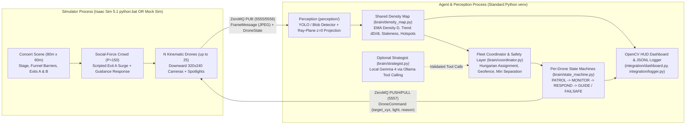

# Crowd-Congestion Monitoring System with Autonomous Drone Fleet (NVIDIA Isaac Sim 5.1)

An embodied multi-agent system built for the **Agentverse 2026 Robotics Track**. A fleet of $N$ autonomous drones (default 4 for development, up to 25 for full venue coverage) monitors an outdoor concert venue (`80 m × 60 m`) with a stage, barriers, an Exit A bottleneck funnel, and a secondary Exit B.

Each drone operates a **Perceive $\rightarrow$ Decide $\rightarrow$ Act** loop using **only** downward RGB camera observations:
1. **Perceive**: Detects pedestrians in downward `320×240` camera frames (local YOLO nano primary detector with high-speed blob/peak fallback), projects each person's bottom-centre pixel onto the ground plane ($z=0$) via ray-plane intersection, computes the 4-corner camera ground footprint polygon, and fuses observations into a shared world-grid density map (`1 m × 1 m` cells).
2. **Decide**: Extracts connected-component `AMBER` ($\ge 3.5\text{ people/m}^2$) and `RED` ($\ge 5.0\text{ people/m}^2$ or rising `AMBER`) hotspots with stable IDs, computes severity scores $\text{area} \cdot \text{peak} \cdot (1 + \max(\text{trend}, 0))$, assigns drones via the Hungarian algorithm (`scipy.optimize.linear_sum_assignment`), and transitions each drone's state machine (`PATROL`, `MONITOR`, `RESPOND`, `GUIDE`, `FAILSAFE`) with hysteresis.
3. **Act**: Moves drones kinematically with minimum-separation repulsion, descends to inspection altitude (`12 m`) over `RED` hotspots, and modulates downward spotlights ($\le 2\text{ Hz}$ smooth sine wave for photosensitivity safety) to visually guide congested crowds from the `Exit_A` bottleneck toward the less-dense `Exit_B`.

> **Hard Rule Enforcement**: The agent and perception pipeline **never** access simulator ground-truth person positions. Ground truth is exported on an isolated ZeroMQ port (`ZMQ_GT_PORT = 5558`) used strictly by offline evaluation and unit tests.

---

## System Architecture



---

## Repository Structure

```text
├── config.py                       # Shared venue, camera, threshold, and ZeroMQ config
├── main.py                         # CLI entry point (--mock and --live modes)
├── interfaces/
│   └── contract.py                 # Versioned dataclasses (FrameMessage, DroneCommand, etc.)
├── perception/
│   ├── detector.py                 # YOLO nano primary + warm-blob fallback detector
│   └── projector.py                # 3D ray-plane (z=0) projection & footprint polygon
├── brain/
│   ├── density_map.py              # World grid EMA fusion, staleness, & hotspot tracker
│   ├── state_machine.py            # Per-drone FSM with hysteresis & FAILSAFE
│   ├── coordinator.py              # Hungarian assignment, coverage memory, & safety layer
│   └── strategist.py               # Optional local Gemma 4 (Ollama) strategic tool caller
├── sim/
│   ├── crowd_dynamics.py           # Shared 2D social-force crowd & kinematic drone physics
│   ├── isaac_env.py                # NVIDIA Isaac Sim 5.1.0 scene, cameras, lights, & bridge
│   └── zmq_bridge.py               # Non-blocking ZeroMQ PUB/SUB & PUSH/PULL endpoints
├── integration/
│   ├── mock_sim.py                 # Standalone synthetic camera & crowd simulator
│   ├── dashboard.py                # OpenCV 3-panel HUD for live demo recording
│   └── logger.py                   # Structured decision logging to runs/<timestamp>.jsonl
├── deliverables/
│   └── benchmark_edge.py           # Edge compute latency & projection accuracy benchmark
└── tests/                          # Pytest suite (contract, projection, density, FSM, E2E)
```

---

## Setup & Installation

### 1. Agent & Perception Virtual Environment
```powershell
python -m venv .venv
.\.venv\Scripts\python.exe -m pip install --upgrade pip pytest numpy scipy opencv-python pyzmq requests
# Optional for local YOLO nano inference:
.\.venv\Scripts\python.exe -m pip install ultralytics
```

### 2. NVIDIA Isaac Sim 5.1 Environment (for `--live` mode)
Verified against **NVIDIA Isaac Sim `5.1.0-rc.19`** installed at `C:\isaacsim`. Ensure `pyzmq` is installed in Isaac Sim's bundled Python:
```powershell
C:\isaacsim\kit\python\python.exe -m pip install pyzmq
```

---

## Running the System

### 1. Mock Mode (No Isaac Sim Required — End-to-End 25 Drones)
Runs the social-force crowd, synthetic downward `320×240` cameras, camera-only perception pipeline, shared density map, fleet coordinator, and OpenCV HUD:
```powershell
# Interactive OpenCV HUD window with 25 drones:
.\.venv\Scripts\python.exe main.py --mock --drones 25

# Headless console verification:
.\.venv\Scripts\python.exe main.py --mock --drones 25 --headless
```

### 2. Live Mode with NVIDIA Isaac Sim 5.1
In **Terminal 1**, start the Isaac Sim 5.1 simulation process:
```powershell
C:\isaacsim\python.bat -m sim.isaac_env --drones 4 --people 150
```
In **Terminal 2**, start the autonomous perception & agent process:
```powershell
.\.venv\Scripts\python.exe main.py --live --drones 4
```

### 3. Run Unit & Integration Tests
```powershell
.\.venv\Scripts\python.exe -m pytest -v
```

### 4. Run Edge-Device Latency Benchmark
```powershell
.\.venv\Scripts\python.exe deliverables/benchmark_edge.py
```

---

## Simulation Assumptions & Safety Notes

1. **Kinematic Drones**: Drones are simulated as holonomic kinematic bodies moving smoothly toward `target_xyz` (capped at `MAX_DRONE_SPEED = 8.0 m/s`) with pairwise horizontal/vertical repulsion (`4.0 m` horizontal, `2.0 m` vertical) rather than 6-DoF rotor aerodynamics.
2. **Modelled Crowd Guidance Response**: When a drone enters `GUIDE` mode above a `RED` hotspot and aims its cyan-green spotlight toward the least-dense exit (`Exit_B`), pedestrians inside the spotlight's ground cone switch their goal to that exit with probability $p = 0.55\text{ s}^{-1}$. This explicitly models human compliance with overhead visual signage.
3. **Crowd-Safety Density Thresholds**: Default thresholds (`AMBER = 3.5 people/m²`, `RED = 5.0 people/m²`) reflect standard crowd-safety guidance (e.g. UK Green Guide / Fruin Level of Service) and must be validated by crowd-safety engineers for real venues.
4. **Photosensitivity Safety**: Spotlight pulsing in `MONITOR`, `RESPOND`, and `GUIDE` states uses a smooth sinusoidal wave strictly capped at $\le 2.0\text{ Hz}$ (`config.MAX_PULSE_HZ`), well below the $3\text{ Hz}$ photosensitive epilepsy hazard threshold.

---

## Known Limitations

- **Flat Ground Plane ($z=0$) Assumption**: Ray-plane projection assumes the venue floor lies at $z=0\text{ m}$; multi-tier stadiums or sloped ramps require a Digital Elevation Map (DEM) lookup during ray intersection.
- **Extreme Nadir Occlusion**: At high crowd densities ($>6\text{ people/m}^2$) and oblique viewing angles near the edge of the camera FOV, adjacent pedestrians can partially occlude one another. Descending from `20 m` (`PATROL`) to `12 m` (`RESPOND`/`GUIDE`) mitigates oblique occlusion directly above hotspots.
- **25-Camera GPU Rendering Budget**: Rendering 25 ray-traced viewports simultaneously in Isaac Sim is GPU-intensive; `sim/isaac_env.py` therefore captures downward cameras in round-robin batches (`MAX_CAMERAS_PER_STEP = 7`) and attaches exact frame timestamps so the density map tracks observation staleness accurately.
